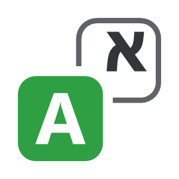

<p align="center"></p>

# AutoLang

Type in the wrong keyboard layout and AutoLang fixes it. `akuo` becomes `שלום`, `יקךךם` becomes `hello`,
and the keyboard switches to the right language for the next words. It works in every normal text field
in Windows: Chrome, Outlook, Word, WhatsApp, VS Code, Explorer and so on.

**Website:** https://bnk989.github.io/AutoLang/ · **Privacy policy:** https://bnk989.github.io/AutoLang/privacy.html

> Early preview (v0.4). It works daily for Hebrew + English; other alphabet pairs are new. Please
> [open an issue](https://github.com/BNK989/AutoLang/issues) for wrong corrections, missed ones or apps
> where it misbehaves.

## Install

Windows 10 (1809+) or 11, 64-bit, with keyboards for at least two different alphabets installed
(for example English + Hebrew, English + Russian). No .NET install needed.

Download from the [latest release](https://github.com/BNK989/AutoLang/releases/latest):

- **`AutoLang.exe`**, portable: a single file, put it anywhere and run it. The exe is unsigned, so SmartScreen warns: **More info → Run anyway**.
- **`AutoLang-x64.msix`**, installer: signed with a test certificate your PC has to trust once.
  Double-click `dev-signing.cer` → **Install Certificate…** → **Local Machine** → **Place all certificates
  in the following store** → **Trusted People** → Finish. Then double-click the `.msix` → **Install**.

A Microsoft Store version is on the way; it will need neither step.

## Use

- Just type. A word that is clearly in the wrong layout is replaced on the next space or Enter, and short
  ambiguous words are fixed once the phrase makes it clear.
- **Tap Shift twice** to switch what you just typed to the other layout. Right after a correction it undoes it and remembers the word, so it is never corrected again; otherwise it converts the text you are typing by hand.
- Keyboards with a Pause key can also use **Pause** (undo) and **Shift+Pause** (convert). Deleting a whole correction and typing the word again also keeps it and remembers it.
- Tray icon: green = watching, grey = paused, orange = this window is skipped (hover for why). Click it to pause or resume.
  Right-click it to pause, disable AutoLang for the current app, change the typing method for an app,
  or manage languages.

More detail, including what to do when an app garbles corrections: [tester notes](src/AutoLang.Host/README-testers.md).

## Privacy

AutoLang has to see keystrokes to work. It keeps only the line you are typing, in memory, and drops it
when you press Enter, click or switch windows. Nothing you type is stored or sent anywhere; there is no
account, analytics or telemetry. The only network use is downloading a public word list for a keyboard
language that does not ship with it (you can turn that off). Password fields, terminals, remote desktops,
VMs and password managers are skipped. Full policy: [PRIVACY.md](PRIVACY.md).

## How it works

Every keystroke is read through a low-level keyboard hook and resolved on each installed layout, so the
current word exists in every alphabet at once. A small engine (word frequency lists plus character n-gram
models, no cloud and no ML runtime) scores each reading of the whole phrase and only acts when one is
clearly better. A separate thread retypes the word and asks the window to switch layout. Design notes,
decisions and evaluation results: [PLAN.md](PLAN.md).

| Project | What |
|---|---|
| `src/AutoLang.Engine` | Layout tables, tokenizer, dictionaries, n-gram models, phrase decisions. No Windows dependencies. |
| `src/AutoLang.Session` | The current run, corrections, undo and learned exceptions. |
| `src/AutoLang.Host` | `AutoLang.exe`: tray app, hooks, focus checks, injection. |
| `tests/AutoLang.Engine.Tests` | Unit tests. |
| `tools/AutoLang.Eval` | Evaluation harness over a sentence corpus. |
| `tools/AutoLang.Assets` | Generates the icons and Store logos. |

## Build

Needs the .NET 8 SDK.

```
dotnet build AutoLang.sln
dotnet test
.\packaging\build-portable.ps1  # portable dist\AutoLang.exe
.\packaging\build-msix.ps1    # MSIX in dist\ (see packaging\STORE.md)
```

The eval corpus is not in the repo; see [data/README.md](data/README.md) to fetch it.

## License

Code: [MIT](LICENSE). Word lists in `data/words` (built into the exe) and those downloaded at runtime:
[FrequencyWords](https://github.com/hermitdave/FrequencyWords) by Hermit Dave, built from OpenSubtitles 2018,
[CC BY-SA 4.0](https://creativecommons.org/licenses/by-sa/4.0/).
